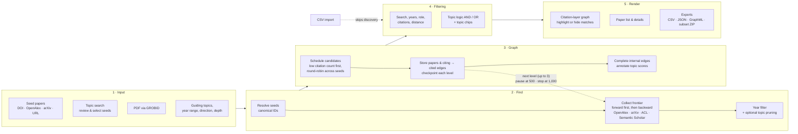

# Citation Grapher

A local-first research literature discovery application. Start with one or more
known papers—or search by topic and select candidate papers—then traverse their
citation neighborhoods, annotate the results, and export reproducible datasets.

The application uses public OpenAlex, Semantic Scholar, and arXiv functionality
and does not require API keys. Semantic Scholar is a bounded fallback when
OpenAlex has no forward-citation records. Optional local GROBID support
identifies uploaded PDFs.

## Features

- Strict breadth-first citation discovery through one to three hops.
- Bounded Boolean topic search with a review-and-select step before graph creation;
  keyless OpenAlex search falls back to arXiv when its shared allowance is unavailable.
- Bounded retries for provider throttling, Semantic Scholar forward-citation
  fallback, and forward-first direction scheduling.
- Deterministic low-citation-count candidate ordering and balanced seed
  frontiers.
- Bounded keyless-provider collection with explicit coverage reporting.
- Restart-safe SQLite checkpoints, an exact pause at 500 papers, and a final
  1,000-paper hard limit.
- Local topic annotation with multi-label similarity scores.
- Linked citation graph and newest-first Discovered Papers list.
- Typed Boolean topic filters with `AND`, `OR`, and parentheses, including
  filtered-subset ZIP exports with referentially consistent CSV and GraphML.
- Non-destructive filters and offline reconstruction from canonical CSV files.
- CSV, JSON metadata, and GraphML exports.

## How it works



Discovery runs on the backend and is checkpointed in SQLite, so an interrupted
run resumes where it stopped. Filtering and rendering run in the browser and
never change the stored graph.

## Local development

Requirements: Python 3.10+ and Node 20+.

```bash
python3 -m venv .venv
source .venv/bin/activate
pip install -e '.[dev,embeddings]'
alembic upgrade head

cd frontend
npm install
npm run dev
```

In another terminal:

```bash
source .venv/bin/activate
uvicorn app.main:app --app-dir backend --reload
```

Open `http://localhost:5173`. The API and interactive documentation are at
`http://localhost:8000` and `http://localhost:8000/docs`.

To use PDF seed identification, run GROBID locally at `http://localhost:8070`,
or start the Docker Compose PDF profile described below.

## Docker Compose

```bash
docker compose up --build
```

The application is available at `http://localhost:5173`. Include the optional
local PDF parser with:

```bash
docker compose --profile pdf up --build
```

Run data is held in the `citation-data` volume. Discovery resumes from the last
committed checkpoint after restarting the backend container.

## Verification

```bash
pytest
cd frontend && npm test && npm run build
```

## Coverage semantics

A run can be complete relative to the data exposed during its attempted
traversal, but the application never claims complete coverage of scholarly
literature. Provider errors, blocked pagination, and application collection
budgets are recorded in `run_metadata.json` and shown in the interface.

## Project documents

- [Comprehensive documentation](DOCUMENTATION.md)
- [Implementation plan](IMPLEMENTATION_PLAN.md)
- [Deferred work](TODO.md)
